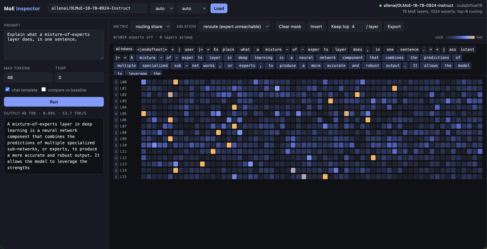
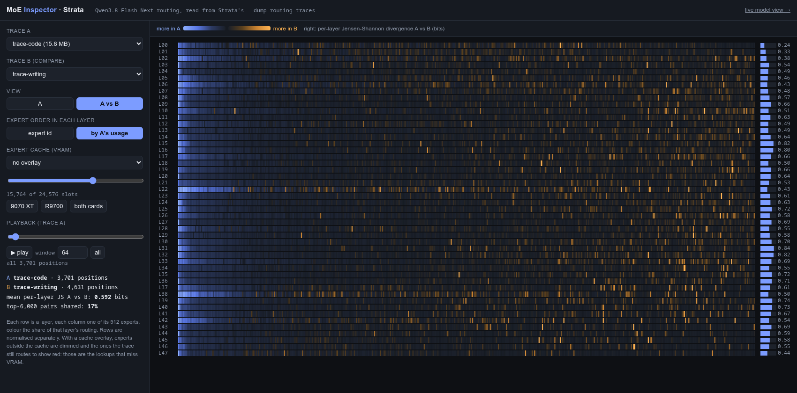
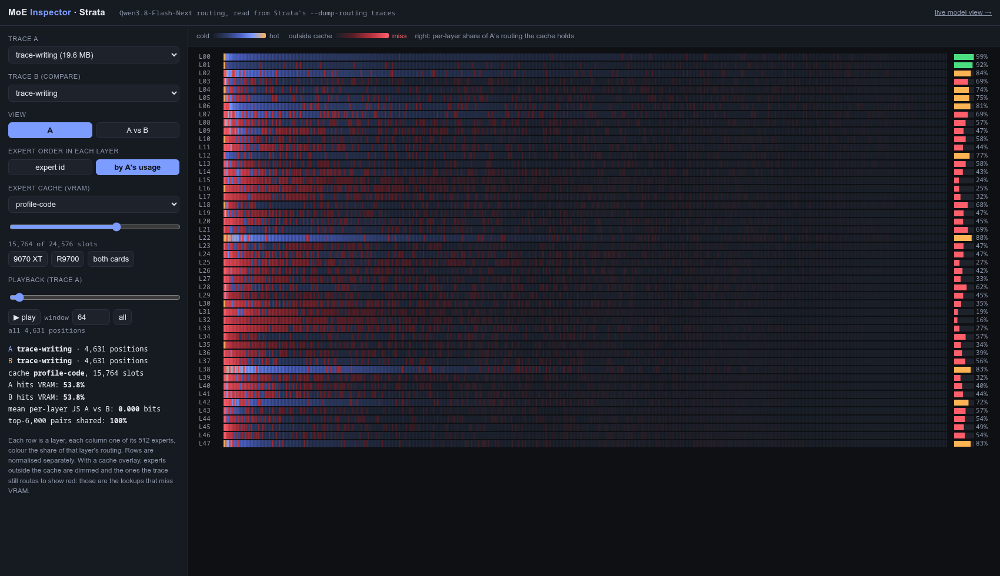

# MoE Inspector

A GUI for looking inside a Mixture-of-Experts model while it generates — and for
switching parts of it off.

Every token in an MoE model is routed to a handful of experts by a small gating
network. This tool taps that router with forward hooks so you can:

- **watch** which experts fire, per layer, per token, as a heatmap
- **disable individual experts** and see how the output changes
- **put whole layers to sleep** (turn them into identity functions)
- **compare** an ablated run against the unmodified baseline, side by side



*OLMoE-1B-7B mid-run: every row is a layer, every column one of that layer's 64
experts, and colour is how often the router picked it across the selected tokens.
Brightness is normalised **per row**, so each layer's busiest expert saturates no
matter how narrow its lead — here the hottest expert takes only ~5-10% of a
layer's traffic against a 1.6% uniform baseline. Click tokens in the strip to see
routing for just those positions.*

Nothing is written to the checkpoint. All of it is forward hooks on the live
model, so clearing the mask restores bit-identical behaviour (there's a test
for exactly that).

## Running it

```bash
uv venv --python 3.12 .venv && uv pip install --python .venv/bin/python -e .
```

Then fetch a checkpoint. Weights are not in this repo — OLMoE alone is 13 GB and
GitHub caps files at 100 MB — so the script pulls them from the Hub instead:

```bash
./scripts/download-model.sh
```

That grabs [`allenai/OLMoE-1B-7B-0924-Instruct`](https://huggingface.co/allenai/OLMoE-1B-7B-0924-Instruct)
(Apache-2.0, 13 GB) pinned to revision `7f1c97f4`, which is what the routing
numbers in [HANDOVER.md](HANDOVER.md) were measured against. Pass a repo id and
optional revision to get something else:

```bash
./scripts/download-model.sh ibm-granite/granite-3.1-3b-a800m-instruct
```

Re-running is cheap — cached files are skipped. Set `HF_TOKEN` for gated repos.

```bash
PYTHONPATH=. .venv/bin/python -m moe_inspector.server --port 8731
```

Then open http://127.0.0.1:8731 and load a model by its HF id. Pass
`--model <id>` to load one at startup instead.

### Models that fit in 16 GB

| model | total / active | shape |
|---|---|---|
| `ibm-granite/granite-3.1-3b-a800m-instruct` | 3.3B / 0.8B | 32 layers × 40 experts, top-8 — 6.2 GiB in bf16 |
| `allenai/OLMoE-1B-7B-0924-Instruct` | 6.9B / 1.3B | 16 layers × 64 experts, top-8 — 12.9 GiB in bf16, measured |

Anything larger (Mixtral-8x7B, Qwen3-30B-A3B, DeepSeek-V3) works too if you
have the RAM or a CUDA box; the code is architecture-agnostic.

## Strata traces: a 177B model's routing, without loading it

`/strata` shows the routing of Qwen3.8-Flash-Next (48 layers × 512 experts,
top-10), which is far too big for transformers here. It runs under
[Strata](https://github.com/Niko1221/Strata), whose engine can write every
routed expert to a file (`--dump-routing FILE`), and whose VRAM expert cache is
seeded from a ranked profile. This view reads both from disk. It needs no torch:
`fastapi uvicorn numpy` is enough.



*Code (A, blue) against English prose (B, orange), each layer sorted by code's
usage. Code concentrates on a block of experts that prose barely touches; prose
spreads over others. Mean per-layer Jensen-Shannon divergence 0.59 bits, top
6,000 (layer, expert) pairs 17% shared. English against Chinese prose: 0.30 bits,
61% shared.*



*The cost of the wrong cache: English prose against a VRAM cache seeded from
code's routing (15,764 slots, what an R9700 holds). Red is routing that misses
VRAM. The page predicts 53.8% hits; Strata measured 51.3% for the same setup
(local-llm-benchmarks, `benchmarks/strata-expert-modes`).*

- **A**: one trace as a heatmap. **A vs B**: the per-layer difference, with the
  JS divergence per layer on the right.
- **Expert cache**: pick a profile and a slot count (presets for a 9070 XT,
  an R9700 and both cards). Experts outside the cache dim, the routed ones turn
  red, and the right-hand bar is each layer's predicted VRAM hit rate.
- **Playback**: a sliding window of positions through trace A.

Traces and profiles are found in `/mnt/fast/strata-exp`,
`~/code/local-llm-benchmarks/benchmarks/strata-expert-modes` and
`~/code/Strata/data`; `--strata-dir DIR` (repeatable) replaces that list.

```bash
uv venv --python 3.12 .venv && uv pip install --python .venv/bin/python fastapi "uvicorn[standard]" numpy
PYTHONPATH=. .venv/bin/python -m moe_inspector.server --port 8731   # then open /strata
```

## The three ablation modes

|  | what happens | use it for |
|---|---|---|
| **reroute** | the expert's router logit is forced to −inf, so tokens pick their next-best expert instead | "does this expert matter, or is a neighbour redundant with it?" |
| **silence** | routing is untouched, but the expert contributes zero — the token wastes a slot | "how much of the output actually comes from this expert?" |
| **sleep** | a whole decoder layer returns its input unchanged | "how load-bearing is this layer?" |

Sleep still *runs* the layer and throws the result away, so the KV cache stays
consistent — it's an ablation, not a speedup.

## Using the GUI

- **Click a cell** to disable that expert; drag to paint across many.
- **`z` next to a layer** puts the whole layer to sleep.
- **Click a token** in the strip to see only that token's routing; shift-click
  for a range, cmd/ctrl-click to add. "all tokens" resets.
- **Keep top-N / layer** disables everything except the N most-used experts in
  each layer, based on the last run — a quick way to find how much of the model
  a given prompt actually needs.
- **Compare vs baseline** runs the prompt twice, ablated and clean.
- **Export** writes the current mask to JSON.

## Architecture support

Blocks are found structurally (a module with an `experts` submodule) rather than
by name, and the router's output tuple is identified by dtype and shape, so tuple
ordering differences don't matter. Verified against `tests/test_architectures.py`:

```
PASS  mixtral       PASS  qwen3_moe    PASS  qwen2_moe    PASS  olmoe
PASS  granitemoe    PASS  gpt_oss      PASS  deepseek_v3
```

```bash
PYTHONPATH=. .venv/bin/python tests/test_architectures.py
```

**One caveat:** reroute recomputes the top-k from masked logits using
softmax-then-renormalise. That's exactly what Mixtral, Qwen, OLMoE, GraniteMoE
and GPT-OSS routers do. DeepSeek-V3's router uses sigmoid scoring with group
limiting and a correction bias, so its rerouted *weights* are an approximation —
the UI flags this when it detects such a router. Silence mode is exact everywhere.

Models with a **shared expert** that runs on every token (Qwen2-MoE, DeepSeek)
are flagged too: that expert isn't routed, so it can't be masked.

## Scripting it

The server is a thin wrapper over `Inspector`, which is usable on its own:

```python
from moe_inspector.session import Inspector

ins = Inspector()
ins._load("ibm-granite/granite-3.1-3b-a800m-instruct", "mps", "float16")

run = ins.generate("Write a haiku about routing.", max_new_tokens=64)
run["trace"][layer][token]  # -> the expert ids that fired

ins.set_mask({"5": [0, 1, 2]}, sleeping=[10], mode="reroute")
ablated = ins.generate("Write a haiku about routing.", max_new_tokens=64)
```

HTTP: `GET /api/status`, `POST /api/load`, `POST /api/mask`, `POST /api/generate`.
